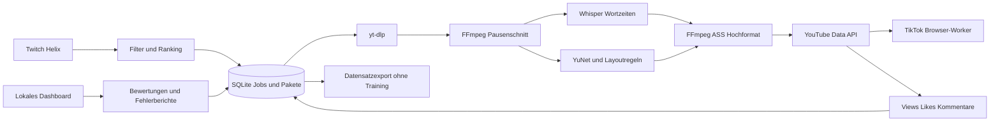

# ClipMac

[](https://github.com/AnsArbi006/clipmac/actions/workflows/tests.yml)

Lokale Twitch-zu-Shorts-Pipeline für macOS: Clips auswählen, Stille kürzen, Hochformat mit Facecam erzeugen, deutsche Wortuntertitel einbrennen und über verbundene Konten veröffentlichen. Diese öffentliche Entwicklungskopie enthält **keine Konten, Clips oder produktiven Betriebsdaten**.

**Nächster Entwickler:** [Aufgaben.md](Aufgaben.md) → [Startauftrag](docs/STARTAUFTRAG.md) → [AGENTS.md](AGENTS.md).

## Schnellstart für Entwicklung (ohne Konten)

Voraussetzungen: Git, macOS und Python **3.10–3.12** (CI: 3.11). Ein unversioniertes `python3` kann eine andere Version sein. Untertiteltests verwenden die mit macOS gelieferte Schrift Arial Bold. Für JavaScript-Prüfungen zusätzlich Node.js 22.

```sh
git clone --recurse-submodules https://github.com/AnsArbi006/clipmac.git
cd clipmac
python3.11 -m venv .venv
.venv/bin/python -m pip install -r requirements-dev.txt
.venv/bin/python -m unittest discover -s tests -v
.venv/bin/python -m clipmac.dev
```

Dashboard: **http://127.0.0.1:8769**. Es enthält drei ausdrücklich synthetische Beispielkarten und erfundene Performance-Messwerte. Ohne FFmpeg gibt es Vorschaubilder, aber keine abspielbaren Videos. Optional mit installiertem FFmpeg und einem frischen Datenverzeichnis:

```sh
.venv/bin/python -m clipmac.dev --data-dir .clipmac-dev/video-demo --with-video
```

Dies erzeugt kurze Farbmuster mit Testton. Keine Streamer-Videos und kein Modell werden heruntergeladen. Der Entwicklungsmodus startet kein Ollama. Stoppen: Strg+C im Terminal.

## Entwicklungsmodus und Datenverzeichnis

- `python -m clipmac.dev` setzt `CLIPMAC_DEV=1` vor dem Import der Anwendung und verwendet standardmäßig `.clipmac-dev/`.
- `--data-dir` bzw. `CLIPMAC_DATA_DIR` bestimmt einen eigenen Datenordner. Im Entwicklungsmodus muss dieser leer oder bereits als Entwicklung markiert sein; `runtime/` und Ordner mit Zugangsdaten werden abgelehnt.
- Uploads, produktive Suche, Kontoanmeldungen und TikTok-Worker sind im Entwicklungsmodus serverseitig gesperrt. Bewertungen, Fehlermeldungen und lokale Vorschauen bleiben testbar.
- Das ist ein Schutz gegen versehentliche Aktionen, keine Sandbox gegen absichtlich veränderten Code. Niemals Produktionsdaten in die Entwicklung kopieren.
- Ohne Entwicklungsmodus bleibt `runtime/` der Standard; `CLIPMAC_DATA_DIR` kann ihn überschreiben. Bestehende Installationen müssen nichts migrieren. Die Umgebungsvariablen vor dem Prozessstart setzen.
- Die komplette Mock-Testsuite **nicht** mit globalem `CLIPMAC_DEV=1` starten: Sie simuliert produktive Aufrufe mit Mock-Objekten. Eigene Isolationstests starten separate Entwicklungsprozesse.

## Was implementiert ist

| Bereich | Umsetzung und Grenze |
| --- | --- |
| Auswahl | Twitch Helix, Ranking nach Aufrufen, Zeitfenster und optionale Kategorieprüfung; Clip-ID- und VOD-Überlappungs-Deduplizierung. Keine ML-Auswahl. |
| Schnitt | Bild und Ton gemeinsam kürzen. Standardmäßig erkennt FFmpeg stille Clipränder ab 0,35 Sekunden und stille Innenpausen ab 0,8 Sekunden. Kurze Puffer und Audio-Fades glätten die Schnitte. |
| Hochformat | 1080×1920; standardmäßig ⅓ Facecam, ⅔ Inhalt; geometrisch erkannte Fullcam-Wechsel. YuNet erkennt Gesichter, die Layoutentscheidung ist heuristisch. |
| Untertitel | faster-whisper small, lokale CPU/int8-Inferenz mit Wortzeiten; ASS mit aktivem Wort, kurzen Gruppen und maximal zwei Zeilen. Eigennamen können falsch erkannt werden. |
| Metadaten | Lokales Ollama/Qwen 2.5 3B formuliert Originaltitel um. Hashtag-Beschreibungen folgen Metadaten; keine erfundenen Teilnehmer. |
| YouTube | OAuth, persistente Warteschlange, Pakete, Quota-Pause, Quittungen und Sperre bei unklarem Uploadausgang. |
| TikTok | Separater lokaler Browser-Worker, Start/Stopp/Fortschritt. Im Paketmodus werden vollständig abgeschlossene YouTube-Pakete übernommen; höchstens fünf Posts, anschließend konfigurierte Pause. Siehe [TikTok](TIKTOK-PILOT.md). |
| Feedback | Gut/Mittel/Schlecht je Schnittfassung; Fehlerbericht mit optionaler Sekunde und lokalen Vergleichsbildern. Korrektur erfolgt durch einen Entwickler. |
| Datensammlung | Views/Likes/Kommentare mit tatsächlichem Messalter; Zielmessungen 1/2/24 Stunden und getrennte Ratios. Kein Training, keine belegte Viralitätsvorhersage. |

Der vorhandene Code stammt aus einer lokal betriebenen Anwendung. Tests simulieren Plattformen; ein grüner CI-Lauf beweist weder aktuelle TikTok-Browser-Kompatibilität noch Live-Uploads, korrekte Facecam in jedem Clip oder bessere Reichweite.

## Profile statt persönlicher Betriebsdaten

Die Code-Defaults sind allgemeine historische Defaults, **nicht** die Konfiguration eines laufenden Kontos. Ein kontofreies Beispiel des vereinbarten GTA-6-Profils steht in [examples/settings.gta6.json](examples/settings.gta6.json): Papaplatte, Zarbex, Trymacs, MontanaBlack88; sieben Stunden, Top fünf pro Streamer, Pakete bis fünf, 60 Minuten Pause. Es enthält keine Kanal-ID und deaktiviert Veröffentlichungen. Die Kategorieprüfung beruht auf Twitch-Metadaten, nicht auf semantischer Prüfung jedes Frames.

Der Start einer Live-Installation bleibt pausiert. Ein ausgeschalteter oder schlafender Mac arbeitet nicht weiter. Lokal gestartete Verarbeitung und Upload-Worker benötigen keine Codex-Aufrufe. Entwicklungsgespräche sind davon unabhängig.

## Vollständige lokale Installation

Die schnelle Entwicklungsinstallation oben genügt für Dashboard/Tests. Für Rendering und echte Plattformanbindung zusätzlich [docs/INSTALLATION.md](docs/INSTALLATION.md) lesen. Modell-Downloads, Kontoverbindungen und Produktionsstart sind ausdrücklich separate Schritte. **GitHub hostet den Quellcode, nicht den laufenden Dashboard-Server.**

## Architektur



## Tests und Veröffentlichung

```sh
.venv/bin/python -m unittest discover -s tests -v
for script in clipmac/*.js; do node --check "$script"; done
.venv/bin/python scripts/check_publication.py
```

Der Veröffentlichungstest prüft Git-Dateiliste und bekannte Geheimnismuster. Er ergänzt die manuelle Diff-Prüfung und ist kein Sicherheitsnachweis für beliebige Inhalte. CI benötigt keine Secrets, Browserinstallation, Modelle oder echten Uploads. Dependencies werden beim Einrichten aus öffentlichen Quellen installiert.

## Lizenz und Weiterentwicklung

Eigener Code: MIT, siehe [LICENSE](LICENSE). Fremdcode und Modelle behalten ihre eigenen Bedingungen: [THIRD_PARTY_NOTICES.md](THIRD_PARTY_NOTICES.md). Die Softwarelizenz erteilt keine Rechte zur Veröffentlichung fremder Clips. Keine automatischen Likes, Kommentare oder künstliche Reichweite; Engagement-Aufgaben betreffen Messung und redaktionelle Qualität.
